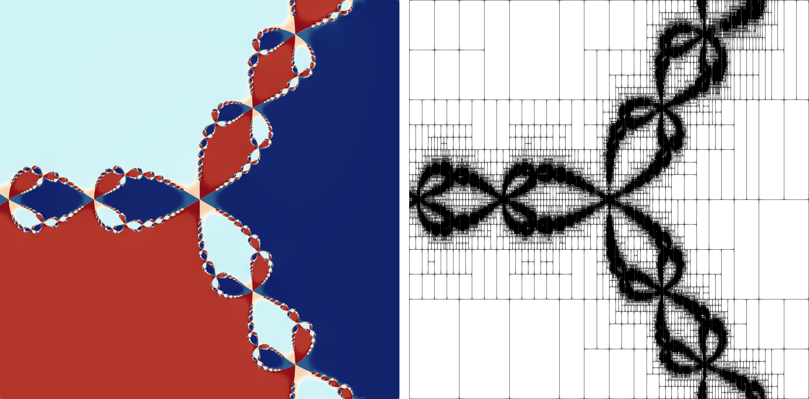

    <picture>
        <source media="(prefers-color-scheme: dark)" srcset="./newton_fractal_fe_solution_dark.png">
        <source media="(prefers-color-scheme: light)" srcset="./newton_fractal_fe_solution_light.png">
        
    </picture> 
    <i>A Grico.jl manufactured Poisson solve on the unit square. The exact solution maps each point to z ∈ [-1.5, 1.5]², applies nine Newton iterations to p(z) = z³ − 1, and turns smooth root-proximity weights into a field with strongly imposed Dirichlet data on a deep mixed-hp adaptive mesh.</i>

