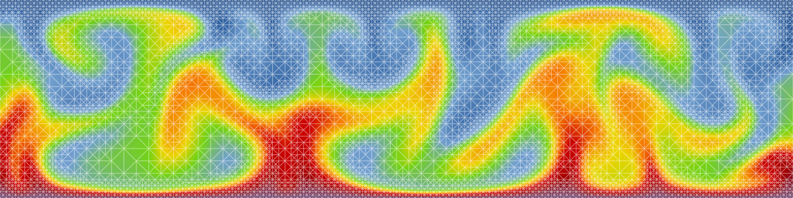

*Hot and cold plumes in Rayleigh–Bénard convection on an adaptively refined mesh, computed with MicroFE.jl:
[tools/plumes.jl](https://github.com/schmaeke/schmaeke.github.io/blob/main/tools/plumes.jl)*

Mechanical engineer by training, working in computational mechanics research at Hochschule Düsseldorf — mostly on
unfitted finite element methods, multi-level hp refinement and immersed boundaries, and the software that goes with
them.

© 2026 Jan Niklas Schmäke. Some rights reserved ([CC BY-NC-SA 4.0](https://creativecommons.org/licenses/by-nc-sa/4.0/)).
